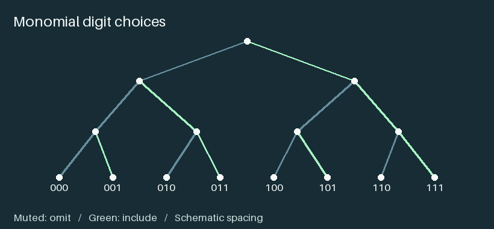

# At least linearly many components in monomial continued-fraction spectra

   

For all sufficiently large integers q, the dimension spectrum for continued fractions with digits in {n^q : n ≥ 1} has at least 2^(floor(log₂ q)−2) connected components, and hence at least q/8.

[Paper](paper/manuscript.pdf) · [TeX](paper/manuscript.tex) · [Original question, §9](https://doi.org/10.1016/j.indag.2026.03.008) · [Catalog Q1537](https://github.com/10m-u/open-problems-catalog/blob/ca8d4d44ba3db527f19f28928c240168f545ecfe/problems/mathematics/differential-equations-dynamical-systems.md#q1537)

## Explore the proof in 3D

The tree shows three inclusion decisions for digits 3^q, 4^q and 5^q. The leaves are placed in lexicographic order. The spaces between them represent strict gaps schematically; distances are not pressure values.

[Download the offline explorer](https://raw.githubusercontent.com/DannyExperiments/monomial-spectrum-components/v1.0.0/visualization/prefix-tree-explorer.zip) · [Explorer source](visualization/index.html) · [Worked example](proof/worked-example.md)

## Proof idea

Conjugating the digit-1 branch to a linear map gives a uniform pressure bracket for all subalphabets containing {1, 2^q}. At the first differing digit m^q, its pressure contribution dominates the entire later tail uniformly through m=floor(log₂ q). Every initial bit pattern occurs, adjacent patterns are strictly separated, and all dimensions missing the base pair lie below them.

[Prior-work comparison](audits/public_safe_reports/LITERATURE.md) · [Scope](CLAIM_SCOPE_AND_LIMITATIONS.md) · [Research disclosure](AI_DISCLOSURE.md)

## Replay

    python3 -I scripts/verify_repository.py
    python3 -I verification/src/replay.py

[Recorded checks](verification/results/replay.txt) · [PDF build](paper/BUILD.md) · [Citation metadata](CITATION.cff)

## Cite

DannyExperiments. *At least linearly many components in monomial continued-fraction spectra*. Version 1.0.0, 27 November 2026. [Version DOI](https://doi.org/10.5281/zenodo.24588795).
